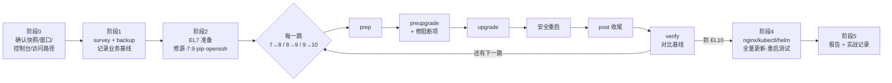

<div align="center">


# CentOS 7 Lighthouse 🗼

**AI 时代，给还在用 CentOS 7 的你一座灯塔。**
把老旧 CentOS 7（以及 CentOS 8）服务器**安全地原地升级到 AlmaLinux 10**，业务不停摆、不失联、可回滚、可验证。

[](https://github.com/seaworld008/centos7-lighthouse/actions/workflows/ci.yml)
[](https://github.com/seaworld008/centos7-lighthouse/releases)
[](LICENSE)
[](https://almalinux.org/)
[](https://docs.claude.com/en/docs/claude-code)
[](AGENTS.md)
<br>
[](field-reports/)
[](field-reports/)
[](skills/centos7-almalinux-upgrade/references/cloud-providers.md)
[](CONTRIBUTING.md)

[English](README.en.md) · [快速开始](#-快速开始) · [工作原理](#-工作原理) · [避坑手册](skills/centos7-almalinux-upgrade/references/pitfalls.md) · [实战报告](field-reports/) · [给 AI Agent](AGENTS.md)

</div>

---

## 💡 为什么需要它

CentOS 7 已于 **2024 年 6 月停止维护**，不再有安全补丁。AI 时代的自动化攻击扫得又快又广，还跑着 CentOS 7 的服务器风险越来越高。

可是这些机器上的业务各不相同：自编译的 nginx、Docker 容器、Java 任务、数据库、VPN……一台台重装太慢，原地升级又怕把业务搞坏。

**原地升级真正的风险往往不在 leapp 本身，而在机器上那些"非官方"的东西。** 这个项目把一次真实生产迁移里踩过的每一个坑，都做成了自动检测、自动处理和救援手册：

| 真实踩过的坑 | 这里怎么防 |
|---|---|
| pip 装进系统目录的 Python 包，让升级在 initramfs 里半途失败 | `survey.sh` 列为 BLOCKER；每跳前自动挪走 |
| 重启前 `docker stop` 了全部容器，VPN 容器开机不自启，整个 VPC 失联 | `hop.sh reboot` 只停有状态且会自启的容器，VPN 容器永不手动停 |
| 自编译 openssh / nginx 依赖 EL7 的库，升级后起不来 | 换回官方 openssh（带自动兜底）；nginx 静态重编，最终换成官方包 |
| 国内镜像 429，docker nightly 源超时，leapp 失败 | 自动改用可用镜像，关掉 test/nightly 源，并探测可达性 |
| cgroup v2 让老应用崩溃；docker-compose v1 在新 Docker 上失效 | cgroup v1 兼容 shim；compose v2 包装脚本 |
| 旧 ifcfg 网卡配置、postfix 依赖 libdb、宿主机 Java 被删…… | 每一跳的阻断项都有对应处理 |

## ✨ 能做什么

- 🔍 **只读勘察**：一条命令列出这台机器升级的分级风险（BLOCKER / HIGH / MEDIUM / INFO）
- 📸 **业务基线**：记录服务、端口、容器、各域名 HTTP 状态码、kubectl。每跳之后自动对比，输出 FAIL / WARN
- 🪜 **逐跳升级**：7→8→9→10，每跳统一走 prep → 预检 → 汇总 → 升级 → 安全重启 → 收尾；耗时任务在后台运行，SSH 断开不受影响
- 🛟 **救援手册**：卡在 initramfs 紧急模式、失联、半升级状态时怎么救
- 🏁 **收尾现代化**：
  - nginx.org 最新稳定版，配好 TLS 1.2/1.3
  - kubectl 对齐集群版本，helm 升到最新
  - Docker 和 compose v2，postfix 改用 lmdb
- 🚀 **批量推进**：并行勘察 → 分类 → 金丝雀 → 分批（阿里云 / 华为云 / AWS）
- 🤖 **为 AI agent 设计**：Claude Code 技能 + 插件。Agent 按流程执行，遇到需要人拍板的事会停下来问你

## 🚀 快速开始

### 方式一：Claude Code 插件（推荐）

```
/plugin install centos7-almalinux-upgrade --marketplace seaworld008/centos7-lighthouse
```

然后直接说："帮我把 10.0.0.11 这台 CentOS 7 升级到最新的 AlmaLinux，业务不能断。"技能会自动加载并按流程推进。

### 方式二：手动安装技能

```bash
git clone https://github.com/seaworld008/centos7-lighthouse.git
cp -r centos7-lighthouse/skills/centos7-almalinux-upgrade ~/.claude/skills/
```

### 方式三：不用 AI，直接用脚本

```bash
pip install paramiko openpyxl
S=centos7-lighthouse/skills/centos7-almalinux-upgrade/scripts
export FLEET_INVENTORY=/path/to/servers.xlsx         # 列: name, host, port, username, password（本地保存，勿提交）

python $S/remote.py web-01 put $S /root/os-upgrade-kit
python $S/remote.py web-01 run "bash /root/os-upgrade-kit/survey.sh"      # 看末尾的 RISK FLAGS
python $S/remote.py web-01 run "bash /root/os-upgrade-kit/backup.sh"      # 记下 BACKUP_DIR
```

之后按 [SKILL.md](skills/centos7-almalinux-upgrade/SKILL.md) 的阶段执行。`MIRROR` 的选择：
- 国内：`https://mirrors.aliyun.com`
- 阿里云内网：`http://mirrors.cloud.aliyuncs.com`
- 海外：`upstream`

## 🧭 工作原理



每一跳之后都和基线对比：业务问题在出现的那一跳就修，不攒到最后。

## ✅ 验证状态（诚实标注）

| 组成 | 状态 |
|---|---|
| 完整流程（人工命令） | ✅ 华为云生产机 CentOS 7.7 → AlmaLinux 10.2 走通，业务全部恢复（[实战报告](field-reports/2026-11-05-huawei-jumphost-docker-vpn.md)） |
| 全程使用脚本：`convert-el8.sh` `hop.sh`（8→9→10） `verify.sh` | ✅ 阿里云堡垒机 CentOS 8.3 → AlmaLinux 10.2，12 个容器、11 个站点和基线一致，最终重启测试通过（[实战报告](field-reports/2026-11-06-aliyun-bastion-docker-centos8.md)） |
| `survey.sh` `backup.sh` `state.sh` `verify.sh` `hop.sh report` | ✅ 真实 EL10 机器实测；CI 在 CentOS 7 / AlmaLinux 8/9/10 容器中冒烟测试 |
| `prep-el7.sh` `swap-openssh.sh`、7→8 这一跳、`finalize.sh` | ⚠️ 由真实迁移中执行过的命令整理而成，尚未作为脚本在新的 CentOS 7 上回归（[#5](https://github.com/seaworld008/centos7-lighthouse/issues/5)） |

**先在非关键机器上试，并做好整机快照。**

## 🗂️ 仓库结构

```
skills/centos7-almalinux-upgrade/   技能本体（SKILL.md + scripts/ + references/ + assets/）
field-reports/                      每次真实升级的脱敏报告，经验从这里沉淀
tools/check_repo.py                 仓库自检：结构、版本一致性、敏感信息
tests/container-smoke.sh            EL7~EL10 容器冒烟测试
.claude-plugin/                     Claude Code 插件与 marketplace 清单
AGENTS.md                           AI agent 维护本仓库的规则（CLAUDE.md 指向它）
```

## 🤖 本仓库由 AI agent 持续进化

这个仓库主要由 AI agent 阅读、执行、改进和沉淀经验，人类负责审核与决策：

```
真实升级 → field-reports/ 记录 → 提炼进 pitfalls.md → 能检测的加进 survey.sh → 能自动化的改进脚本
```

Agent 请先读 [AGENTS.md](AGENTS.md)。人类贡献者请看 [CONTRIBUTING.md](CONTRIBUTING.md)。**最有价值的贡献是你的实战报告**，失败的也算。

## ⚠️ 安全须知

- 开始前一定做**整机快照**（系统盘 + 数据盘），这是唯一完整的回滚手段
- 提前确认云控制台的 VNC 或串口能用
- 脚本以 root 身份运行，用前请先审阅；资产表只放在本地，绝不提交
- 详见 [SECURITY.md](SECURITY.md)

## 📜 许可证

[MIT](LICENSE)。本项目基于 AlmaLinux 的 [ELevate](https://wiki.almalinux.org/elevate/) 与 [Leapp](https://github.com/oamg/leapp)，向这些项目致谢。

<div align="center"><sub>如果它帮你的服务器平稳上岸，点个 ⭐ 让更多人看到这座灯塔。</sub></div>
